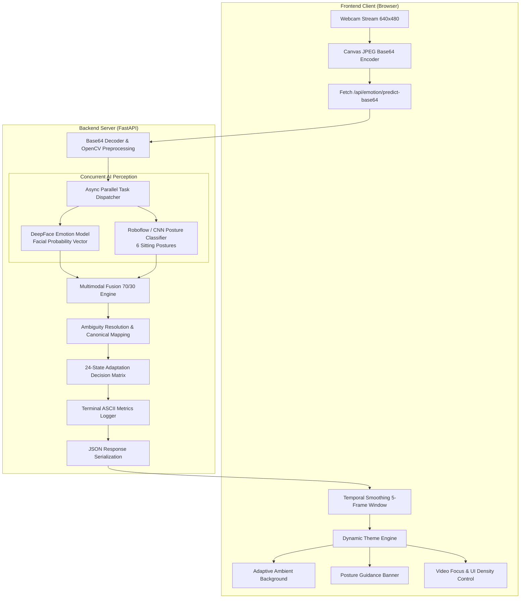

# EduMotion: Multimodal Emotion & Posture-Aware Adaptive Learning Platform
## Comprehensive Technical Project Report & Architectural Documentation

---

## 1. Executive Summary & Project Overview

### 1.1 Problem Statement
Traditional Computer-Based Training (CBT) and online learning platforms (e.g., Coursera, Udemy, edX) deliver identical user experiences regardless of the learner's cognitive, physiological, or emotional state. When students encounter difficult concepts, they often experience **frustration** or **confusion**; when content lacks engagement, they experience **boredom** or fatigue; and prolonged poor sitting habits cause physical strain. Without real-time human instructor observation, these negative states lead to high course drop-out rates, cognitive overload, and diminished knowledge retention.

### 1.2 The EduMotion Solution
**EduMotion** is an intelligent, real-time, closed-loop educational technology platform that bridges the gap between digital content and human affect. By combining computer vision, deep learning facial emotion recognition, sitting posture classification, and statistical cognitive heuristics, EduMotion continuously evaluates learner engagement and dynamically reconfigures the learning interface in real-time.

```
+---------------------------------------------------------------------------------------+
|                                    EDUMOTION VISION                                   |
|                                                                                       |
|   [Learner Webcam] ---> [DeepFace + Posture CNN] ---> [Multimodal Fusion Engine]      |
|                                                                   |                   |
|                                                                   v                   |
|   [Optimal Learning State] <--- [Dynamic UI/Theme] <--- [24-State Adaptation Matrix]  |
+---------------------------------------------------------------------------------------+
```

---

## 2. System Architecture & Core Workflow

EduMotion operates on a high-throughput, asynchronous client-server architecture engineered for sub-second affective computing and low-latency UI responsiveness.



### 2.1 Step-by-Step Workflow Pipeline

1. **Client Frame Acquisition**: The browser client captures video frames at fixed intervals via HTML5 `getUserMedia` and an offscreen canvas rendering buffer.
2. **Payload Transmission**: Compressed JPEG Base64 payloads are posted to the FastAPI endpoint (`/api/emotion/predict-base64`).
3. **Asynchronous Parallel Processing**:
   - `DeepFaceEmotionService` extracts 7 facial emotion probabilities (`happy`, `surprise`, `neutral`, `sad`, `fear`, `disgust`, `angry`).
   - `SittingPostureService` predicts ergonomic orientation (`upright`, `leaning_forward`, `leaning_backward`, `leaning_left`, `leaning_right`, `slouched`).
4. **Multimodal Weight Fusion (70% / 30%)**:
   - **70% weight** allocated to facial expression probabilities.
   - **30% weight** allocated to posture-derived engagement priors.
   - Ambiguous `neutral` emotions are dynamically resolved into `engaged` or `bored` using learning priors.
5. **Canonical 4-State Mapping**: Output is mapped to one of the 4 primary learning states: **Engaged**, **Bored**, **Confused**, or **Frustrated**.
6. **24-State Adaptation Lookup**: The system evaluates the `(Emotion, Posture)` pair against the 24-combination adaptation matrix to yield tailored messages, posture tips, UI color schemes, and interaction density.
7. **Frontend State Application & Smoothing**: The client applies rolling-window temporal smoothing to eliminate flicker and immediately transitions the full-page atmospheric theme and guidance widgets.

---

## 3. Technology Stack & Technical Deep-Dive

| Subsystem | Technology / Library | Purpose & Implementation |
| :--- | :--- | :--- |
| **Facial AI** | `DeepFace`, `TensorFlow`, `TF-Keras` | Pre-trained deep convolutional neural networks extracting facial landmark attributes and emotion vectors. |
| **Vision Preprocessing** | `OpenCV (cv2)`, `NumPy`, `Pillow` | Frame decoding, BGR-to-RGB conversion, normalization, and tensor formatting. |
| **Posture AI** | Custom CNN & Cloud Inference API | Multi-class spatial classification of torso and head alignment across 6 posture states. |
| **Backend Core** | `FastAPI`, `Uvicorn`, `asyncio` | High-concurrency ASGI web framework handling asynchronous I/O and non-blocking model execution. |
| **Data Contracts** | `Pydantic v2` | Strict schema validation, automatic serialization, and request/response typing. |
| **Frontend UI/UX** | Modern Vanilla JavaScript (ES6+), CSS3 | Dynamic CSS variable theming, glassmorphism, responsive video player, and DOM animation controllers. |

---

## 4. Mathematical Formulation & Multimodal Fusion Model

EduMotion employs a hybrid affective computing model that fuses raw facial probabilities with ergonomic posture signals.

$$\text{FinalScore}(s) = 0.70 \cdot \mathbf{S}_{\text{facial}}(s) + 0.30 \cdot \mathbf{S}_{\text{learning}}(s), \quad \forall s \in \{\text{engaged}, \text{bored}, \text{confused}, \text{frustrated}\}$$

### 4.1 Facial Scoring ($\mathbf{S}_{\text{facial}}$)
Raw DeepFace probabilities $P(e)$ for $e \in \{\text{happy}, \text{surprise}, \text{neutral}, \text{sad}, \text{fear}, \text{disgust}, \text{angry}\}$ are mapped to target states using base weighting coefficients $w_e$:

| Raw DeepFace Emotion | Canonical State | Base Weight ($w_e$) | Rationale |
| :--- | :--- | :---: | :--- |
| `happy` | **Engaged** | $0.90$ | High positive valence, active interest. |
| `surprise` | **Engaged** | $0.70$ | Cognitive arousal and novelty detection. |
| `neutral` | **Ambiguous** | $0.60$ | Resolved via posture/stats (Engaged if alert, else Bored). |
| `sad` | **Bored** | $0.55$ | Low valence and low cognitive energy. |
| `fear` | **Confused** | $0.75$ | Cognitive dissonance, uncertainty, and struggle. |
| `disgust` | **Frustrated** | $0.80$ | Strong negative reaction to difficulty or friction. |
| `angry` | **Frustrated** | $0.90$ | Peak negative intensity and acute resistance. |

### 4.2 Learning & Posture Scoring Prior ($\mathbf{S}_{\text{learning}}$)
Posture acts as a strong physiological confirmation signal:
- $\text{Upright} \implies \text{High Engaged prior } (0.85)$
- $\text{Leaning Forward} \implies \text{Shared Engaged / Confused prior } (0.50 / 0.40)$
- $\text{Leaning Backward} \implies \text{Passive Review / Bored prior } (0.50)$
- $\text{Slouched / Leaning Aside} \implies \text{Fatigue / Bored prior } (0.70)$

---

## 5. The 24-State Adaptation Matrix

EduMotion defines a centralized $4 \times 6$ adaptation matrix providing fine-grained educational interventions:

| Learning State | Detected Posture | UI Theme Accent | Educational Action | Ergonomic Posture Guidance |
| :--- | :--- | :--- | :--- | :--- |
| **ENGAGED** | Upright | Emerald Glow (`#22c55e`) | High-density content delivery | Peak posture maintained. |
| **ENGAGED** | Leaning Forward | Emerald Glow (`#22c55e`) | Deep focus mode | Keep distance from screen to prevent eye strain. |
| **ENGAGED** | Leaning Backward| Emerald Glow (`#22c55e`) | Passive review density | Ensure lower back support is engaged. |
| **ENGAGED** | Slouched | Emerald Glow (`#22c55e`) | Gentle posture nudge | Roll shoulders back to maintain airflow. |
| **ENGAGED** | Leaning Left/Right| Emerald Glow (`#22c55e`) | Standard delivery | Distribute weight evenly across hips. |
| **BORED** | Upright | Ocean Blue (`#60a5fa`) | Re-engagement interactive quiz | Great posture! Take a micro-stretch. |
| **BORED** | Leaning Forward | Ocean Blue (`#60a5fa`) | Dynamic concept check | Straighten spine to boost alertness. |
| **BORED** | Leaning Backward| Ocean Blue (`#60a5fa`) | Gamified challenge pop-up | Sit upright to re-engage active focus. |
| **BORED** | Slouched | Ocean Blue (`#60a5fa`) | 2-minute energizer prompt | Stand up or stretch to shake off fatigue. |
| **BORED** | Leaning Left/Right| Ocean Blue (`#60a5fa`) | Shift to interactive mode | Re-center yourself for active learning. |
| **CONFUSED** | Upright | Royal Indigo (`#818cf8`) | Step-by-step breakdown | Alert focus detected; take time on concepts. |
| **CONFUSED** | Leaning Forward | Royal Indigo (`#818cf8`) | Visual aid / diagram expansion| Relax neck muscles while studying diagrams. |
| **CONFUSED** | Leaning Backward| Royal Indigo (`#818cf8`) | Foundational summary recap | Re-center and review prerequisite definitions. |
| **CONFUSED** | Slouched | Royal Indigo (`#818cf8`) | Bite-sized micro-steps | Sit upright to clear cognitive fatigue. |
| **CONFUSED** | Leaning Left/Right| Royal Indigo (`#818cf8`) | Scaffolded hints | Keep head upright for balanced viewing. |
| **FRUSTRATED** | Upright | Coral Rose (`#ef4444`) | Calm breathing & pacing prompt | Relax jaw and drop shoulders. |
| **FRUSTRATED** | Leaning Forward | Coral Rose (`#ef4444`) | Simplify task complexity | Ease forward tension and breathe deeply. |
| **FRUSTRATED** | Leaning Backward| Coral Rose (`#ef4444`) | Offer optional break | Lean back and take 3 deep breaths. |
| **FRUSTRATED** | Slouched | Coral Rose (`#ef4444`) | Rest mode & guided walkthrough| High strain detected; pause for 60 seconds. |
| **FRUSTRATED** | Leaning Left/Right| Coral Rose (`#ef4444`) | De-escalate difficulty | Re-align posture and reset pacing. |

---

## 6. Core Contributors & Team Roles

| Contributor | Specialized Role | Primary Contributions & Responsibilities |
| :--- | :--- | :--- |
| **SACHIN SINGH** | **AI / ML Lead** | DeepFace facial emotion integration, multimodal mathematical scoring formula, CNN posture model training, and ambiguity resolution algorithms. |
| **DIVYA CHAUDHARY** | **Backend Architect** | FastAPI asynchronous server architecture, 24-state adaptation matrix engine, REST API contracts, Pydantic schemas, and server performance optimization. |
| **SHUBHAM SHARMA** | **Frontend & UX Lead** | Dynamic CSS adaptive theme engine, live webcam capture module, YouTube player integration, temporal prediction smoothing, and accessible UI layout. |

---

## 7. Future Scope & Research Directions

1. **Eye-Tracking & Gaze Fixation Analysis**:
   - Integrating WebGazer.js or MediaPipe Iris to track reading patterns, fixations, and saccades to detect reading fatigue and zoning out.
2. **Speech & Audio Prosody Emotion Recognition**:
   - Analyzing learner verbal responses, pitch variations, and hesitations during interactive voice-based quizzes.
3. **Reinforcement Learning from Learner Feedback (RLLF)**:
   - Implementing contextual multi-armed bandits or Q-learning to personalize which interventions (quizzes vs. breaks vs. visual aids) produce the highest recovery rate for specific individuals.
4. **Automated Content Difficulty Scaling with LLM Tutors**:
   - Connecting the adaptation engine to a local or cloud LLM (e.g., Gemini / Claude) to dynamically generate tailored explanations when a student is `confused`.
5. **Wearable Physiological Sensing**:
   - Fusing photoplethysmography (PPG) heart-rate variability (HRV) and galvanic skin response (GSR) from smartwatches to measure autonomic stress and cognitive load.

---

## 8. Scalability, Deployment & Production Engineering

### 8.1 Horizontal Scaling & Microservices Architecture
To support hundreds of thousands of concurrent learners:
- **Client-Side Edge Inference (ONNX Runtime Web / WebAssembly)**: Offload facial feature extraction directly to learner GPUs/CPUs using WebAssembly, transmitting lightweight vector embeddings (128-d) instead of raw video frames to reduce backend compute costs by 95%.
- **Container Orchestration**: Package the FastAPI inference service into multi-stage Docker containers managed by Kubernetes (EKS/GKE) with Horizontal Pod Autoscalers (HPA) triggered by GPU/CPU thresholds.
- **Asynchronous Message Bus**: Route inference requests through Redis Streams or Apache Kafka to buffer burst traffic during peak classroom hours.

### 8.2 Privacy, Data Protection & Edge Security
- **Zero Video Retention Policy**: Video frames are processed in volatile memory and never persisted to disk.
- **GDPR & FERPA Compliance**: On-device face blurring, differential privacy for analytics, and local client-side metadata synthesis to ensure compliance with student privacy regulations.

---

*EduMotion — Reimagining digital education through empathetic, adaptive, and intelligent technology.*
